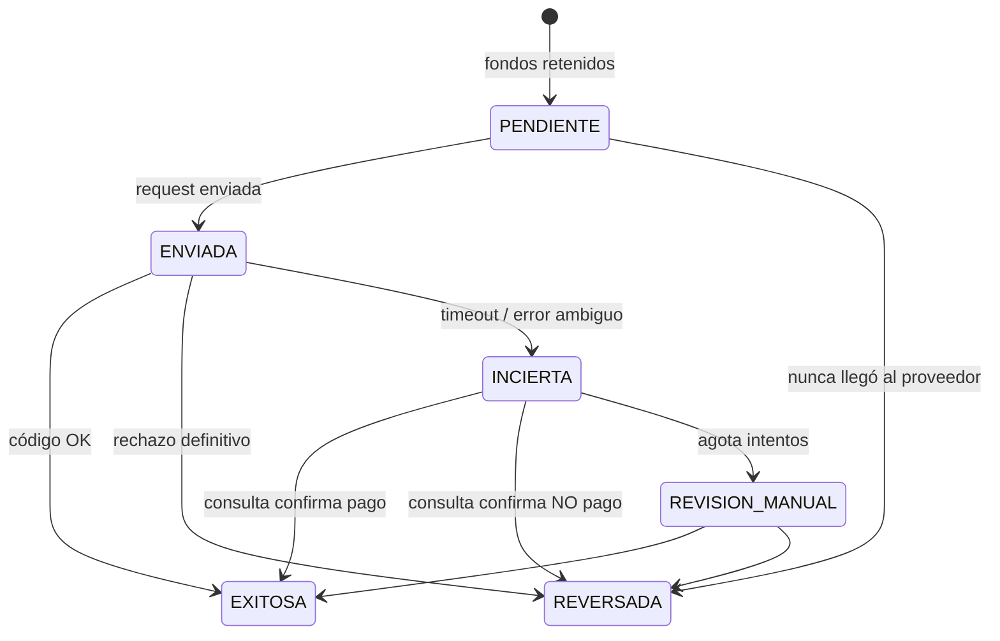

# GUÍA DE IMPLEMENTACIÓN — Pago de servicios con Gestopago (`sendTx.do`)

> Proyecto: Spring Boot 3.3.6 · Java 17 · Gradle · PostgreSQL (cuentas/ledger) · MongoDB (catálogo) · OpenFeign
> Paquete base: `com.proyecto.servicios`
> Endpoint proveedor: `POST https://gestopago.portalventas.net/sistema/service/sendTx.do` (autenticación `Bearer`)

---

## 0. Cómo leer esta guía

1. **§1** interpreta el diagrama y señala dónde debe **corregirse** el orden (importante).
2. **§2** es el diagnóstico del código actual: riesgos que ya existen y bloquean una integración financiera.
3. **§3–§12** son los pasos de implementación, en orden.
4. **§13** es la matriz de trazabilidad: cada punto del enunciado → sección de esta guía.
5. **§14** es el checklist final de aceptación.

> [!NOTE]
> **Documentación Oficial de PuntoRed / Gestopago Analizada:**
> Esta guía se fundamenta en la especificación técnica oficial del API de PuntoRed (`sendTx.do`, `confirmTx.do`, cifrado AES-256-CBC, `upc`, `tipoFront`, y catálogo de respuestas). Todos los parámetros, códigos y algoritmos reflejan exactamente el estándar del proveedor.

---

## 1. Análisis del diagrama

### 1.1 Lectura del diagrama (contrastada con la documentación oficial)

```
POST (cliente → nuestra API)                    Payload (nuestra API → Gestopago)
  NumCuenta                                       IdProducto  → idProducto
  IdServicio                                      IdServicio  → idServicio
  IdDocumento                                     Teléfono/Referencia → telefono / referencia
  Precio                                          Hora local  → horaLocal (yyyyMMddHHmmss)
  Distribuidor                                    Monto Pago  → montoPago (sólo pago de servicios)
  Teléfono/Referencia                             UPC         → upc (3-15 caracteres, único)
  Bandera                                         Unidad      → unidad (3-25 caracteres)
  Pin                                                 │  "Firmar" = cifrar el JSON (AES-256-CBC → Base64)
     │                                                ▼
     ├─► Cuenta Activa ─► Saldo                      AES ─► Obtener Token (BD) ─► POST sendTx.do ─► CODIGO "01" │ descontar saldo
     └─► Pass seguro (PIN)                                   (campos form: random + signed)
```

### 1.2 Significado de cada bloque y decisión de diseño

| Elemento del diagrama | Interpretación según la documentación | Decisión / riesgo |
|---|---|---|
| `NumCuenta` | Cuenta origen de los fondos (nuestra, no de Gestopago) | Validar formato, existencia y **que pertenezca al usuario del JWT** (evita IDOR). |
| `IdServicio`, `IdProducto` | Van en el payload (`idServicio`, `idProducto`) y deben salir de `getProductList` | Validar contra el catálogo (Mongo `cat_productos`); el servicio debe **corresponder** al producto (§5.2). |
| `IdDocumento` | **No existe** en el API de Gestopago. Es nuestra llave de idempotencia interna | El identificador que Gestopago sí usa para detectar duplicados es el `upc` (§6.3). |
| `Precio` / `Monto Pago` | `precio` del catálogo = **precio final** si `tipoFront=1`, pero = **comisión** si `tipoFront=2`. `montoPago` sólo aplica a pago de servicios (`tipoFront=2`) | El cliente **no decide el precio** en `tipoFront=1`. En `tipoFront=2` el monto lo escribe el cliente y se valida (§5.3). |
| `Distribuidor` | Sólo se usa en `/authenticate` (`idDistribuidor`). **No va en el payload de `sendTx`** | Sale de configuración segura; fuera del DTO público. |
| `Teléfono/Referencia` | Campos `telefono` (10–20) y `referencia` (1–100); cuál se usa depende de `tipoFront` / `tipoReferencia` | Reglas en §5.2. Enmascarar en logs. |
| `Bandera` | **No aparece en la documentación de Gestopago** | Si es un dato interno, no debe viajar al proveedor; si no tiene uso, eliminarla. |
| `UPC` | *Unique Payment Code*: identificador único de la operación, 3–15 caracteres, **generado por el integrador** | Lo genera el servidor (§6.3). Es la base de la idempotencia frente al proveedor. |
| `Unidad` | Nombre o código de sucursal, 3–25 caracteres | Constante de configuración (`gestopago.unidad`), no viene del cliente. |
| `Hora local` | `horaLocal`, formato `yyyyMMddHHmmss` | La genera el servidor (`Clock` inyectable) y **se guarda**: `confirmTx` debe usar exactamente la misma. |
| `Pin` / `Pass seguro` | Es **nuestro** PIN transaccional; Gestopago no lo conoce | BCrypt, contador de intentos y bloqueo (§4.4). Nunca viaja al proveedor ni a logs. |
| `Cuenta Activa` → `Saldo` | Validación previa sobre **nuestra** cuenta | Se valida **bajo bloqueo de fila** para evitar carreras (§7). |
| `Firmar` → `AES` | No es una firma: es **cifrado AES-256-CBC** (PKCS5, Base64) del JSON. Se envía en el campo `signed`, junto a `random` | Detalle en §8.4. La llave e IV los entrega PuntoRed. |
| `Obtener Token ↓ BD` | JWT de PuntoRed con vigencia de **24 h**; se debe pedir **un token por día** | La BD sirve para compartir el token entre instancias (§8.2). |
| `POST SendTx` | `POST /sistema/service/sendTx.do`, `application/x-www-form-urlencoded`, `Authorization: Bearer`, `X-API-Key` opcional | §8.1. |
| `Código \| descontar saldo` | `CODIGO` del XML de respuesta | ⚠️ Ver 1.3 y 1.4: el flujo del diagrama debe cambiar. |

### 1.3 ¿Qué es el "Código"? (¿1, 0 o 01?)

Es **`01`**, es decir, el texto literal de dos caracteres `"01"` (cero-uno). No es un booleano `1/0`.

Gestopago **siempre responde HTTP 200** con un XML; el resultado de la transacción viene dentro de `<RESPONSE><MENSAJE><CODIGO>`. La regla oficial documentada por PuntoRed es:
> *"Other value than '01' is an error"*. (Cualquier valor distinto de "01" es un error).

Ejemplo de respuesta exitosa de `sendTx.do`:
```xml
<RESPONSE>
    <ID_TX>291437188</ID_TX>
    <NUM_AUTORIZACION>100024988</NUM_AUTORIZACION>
    <SALDO>157731.83</SALDO>        <!-- Saldo prepagado del DISTRIBUIDOR en Gestopago, NO del cliente -->
    <COMISION>0.7</COMISION>
    <FECHA>25/Feb/2022 18:15:25</FECHA>
    <MONTO>10.0</MONTO>
    <MENSAJE>
        <CODIGO>01</CODIGO>         <!-- 01 = ÉXITO; cualquier otro valor = error -->
        <TEXTO>Operacion realizada con exito</TEXTO>
        <REFERENCIA></REFERENCIA>
    </MENSAJE>
</RESPONSE>
```

#### Catálogo oficial de códigos en `sendTx.do` y `confirmTx.do`:

| `CODIGO` | Endpoint | Significado oficial | `NUM_AUTORIZACION` | Acción con el saldo del cliente |
|---|---|---|---|---|
| **`01`** | sendTx | **Operación realizada con éxito** | Número de autorización real (+ `ID_TX`) | **Confirmar débito**: El cargo retenido queda firme (`EXITOSA`). |
| **`02`** | sendTx | **Saldo insuficiente** (de la cuenta del *distribuidor* en Gestopago, **no** del cliente) | `-1` | **Reversar débito**: Reacreditar de inmediato al cliente. Alerta operativa por falta de fondo en Gestopago. |
| **`06`** | sendTx | **Transacción aplicada anteriormente** (detectada como duplicada por `upc` o por servicio+monto en ventana) | Folio de la tx previa | **Mantener retenido (INCIERTA)**: Consultar con `confirmTx.do` para confirmar si fue esta u otra operación. |
| **`82`** | sendTx | **Tiempo de espera alcanzado** (62 segundos): "la transacción no ha sido registrada" | `-1` | **Mantener retenido (INCIERTA)**: Gestopago exige invocar obligatoriamente `confirmTx.do` tras ≥ 62 s. |
| **`06`** | **confirmTx** | **La transacción SÍ fue aplicada exitosamente** | Folio de autorización real (+ `ID_TX`) | **Confirmar débito**: La transacción queda confirmada (`EXITOSA`). |
| **`70`** | **confirmTx** | **La transacción NO fue aplicada** | `0` (`ID_TX`: `-1`) | **Reversar débito**: Reacreditar saldo al cliente (`REVERSADA`). |
| *HTTP 403* (`EXPIRED`) | Cualquier endpoint | Token JWT de PuntoRed expirado (vida útil de 24 horas) | — | Renovar token y reintentar 1 sola vez con el mismo `upc`. |

> [!WARNING]
> **Atención al código `06`:**
> En `sendTx.do`, `06` significa *"posible duplicado/transacción aplicada anteriormente"*; mientras que en `confirmTx.do`, `06` es la respuesta oficial de **ÉXITO** (*"La transacción fue aplicada exitosamente"*). Por eso el sistema debe tener clasificadores separados para cada endpoint (§8.5).

**Regla de parseo en Java:**
```java
// Limpiar espacios y comparar como texto exacto o entero
boolean esExito = "01".equals(codigoXml.trim()) || Integer.parseInt(codigoXml.trim()) == 1;
```
Nunca se debe evaluar como booleano débil `1` vs `0`.

---

### 1.4 ⚠️ Corrección obligatoria al flujo del diagrama: No descontar el saldo *después* del código

El diagrama original indica:
`POST SendTx ──► Código | descontar saldo`

Eso implicaría: enviar la petición a Gestopago, recibir el código, y **después** descontar el saldo de la cuenta del cliente.
**Esto es sumamente peligroso en entornos financieros y de pagos de servicios:**

1. **Riesgo de sobregiro por concurrencia:** Si un cliente con $100 realiza 2 solicitudes simultáneas de $100, ambas llamadas a Gestopago pasan la validación previa en paralelo; ambas se procesan en el proveedor y, al momento de descontar después, la segunda solicitud dejaría la cuenta en saldo negativo (-$100).
2. **Riesgo de pérdida financiera ante Timeout (62s):** Si `sendTx.do` experimenta un timeout de red o el código `82`, la aplicación no tiene un código exitoso inmediato. Si no se descontó previamente, Gestopago pudo haber aplicado la recarga/pago en los switches telefónicos o de luz, y nuestro banco **nunca le cobró al cliente**.
3. **Caída del servidor o reinicio:** Si el servidor se apaga o reinicia justo en el milisegundo posterior a recibir la respuesta de Gestopago pero antes de persistir el descuento, el cliente recibe el servicio gratis.

**Solución Arquitectónica: Patrón Reserva Previa (Hold) → Envío → Confirmación / Reverso:**

```
1) [TX de BD corta #1]:
   - SELECT FOR UPDATE de la cuenta del cliente.
   - Validar saldo suficiente (>= monto).
   - Generar 'upc' único y 'horaLocal' (yyyyMMddHHmmss).
   - INSERT en 'transacciones_servicio' (estado = 'PENDIENTE').
   - INSERT en 'movimientos_cuenta' (tipo = 'DEBITO', retención de fondos).
   - UPDATE saldo = saldo - monto.
   COMMIT (libera el bloqueo de BD de inmediato).

2) [Paso HTTP - SIN transacción de BD abierta]:
   - POST /sistema/service/sendTx.do con payload JSON cifrado en AES-256-CBC.
   - Recibir respuesta XML y extraer <CODIGO>.

3) [TX de BD corta #2]:
   - Según el <CODIGO>:
     * Si CODIGO == "01": 
       UPDATE transacción a 'EXITOSA' (el débito queda confirmado).
     * Si CODIGO == "02" (u otro rechazo definitivo no procesado):
       INSERT en 'movimientos_cuenta' (tipo = 'REVERSO').
       UPDATE saldo = saldo + monto.
       UPDATE transacción a 'REVERSADA'.
     * Si Timeout (ReadTimeoutException), error de red, o CODIGO "82" / "06":
       UPDATE transacción a 'INCIERTA' (los fondos SIGUEN retenidos).
       Se programa job de conciliación que ejecutará 'confirmTx.do' tras >= 62 segundos.
```

> [!IMPORTANT]
> **Diferencia entre los dos saldos:**
> - `cuentas.saldo`: Es el dinero **del cliente bancario** en nuestra base de datos relacional.
> - `<SALDO>` (en el XML de Gestopago): Es el saldo **del comercio/distribuidor** en la plataforma prepagada de PuntoRed. Si Gestopago devuelve código `02` (Saldo insuficiente), significa que **nuestro negocio** se quedó sin saldo con PuntoRed, NO que el cliente final no tenga dinero. Jamás se debe sincronizar el `<SALDO>` del XML con la cuenta del cliente.

---

## 2. Diagnóstico del código actual (riesgos existentes)

Revisé `build.gradle`, `application.properties`, el cliente Feign, `GestoPagoTokenServiceImpl`, `CatProductoServiceImpl`, `Cuenta`, `CuentaRepository`, `CuentaServiceImpl`, `CuentaController`, `GlobalExceptionHandler`, `SecurityConfig` y `JwtAuthenticationFilter`.

### 2.1 Críticos (resolver **antes** de escribir el flujo)

| # | Hallazgo | Dónde | Acción |
|---|---|---|---|
| C1 | **Secretos con valores por defecto en el repo**: contraseña de MongoDB Atlas, contraseña de PostgreSQL, `jwt.secret`, password y dispositivo de Gestopago | [application.properties](file:///c:/Proyectos/Hasani/prueba/src/main/resources/application.properties) líneas 16, 21-23, 32-34, 67 | Quitar **todos** los defaults. **Rotar** las credenciales ya expuestas (quedan en el historial de Git). Ver §3. |
| C2 | Se **loguea parte del token** Bearer | [GestoPagoTokenServiceImpl](file:///c:/Proyectos/Hasani/prueba/src/main/java/com/proyecto/servicios/service/Impl/GestoPagoTokenServiceImpl.java#L77) línea 77 | Eliminar; loguear sólo "token renovado, expira en X". |
| C3 | Token guardado **en claro** en BD (`gestopago_tokens.token`) | `GestoPagoToken` | Cifrar en reposo o mantener sólo en memoria (§8.2). |
| C4 | `PATCH /cuentas` permite **fijar el saldo** libremente | [CuentaServiceImpl.patchCuenta](file:///c:/Proyectos/Hasani/prueba/src/main/java/com/proyecto/servicios/service/Impl/CuentaServiceImpl.java#L155) | Eliminar el campo `saldo` del PATCH o restringir a `ROLE_ADMIN` y registrar en ledger. |
| C5 | Endpoints de cuenta reciben `numeroCuenta` **sin verificar propiedad** (IDOR) | `CuentaController` | Comparar `cuenta.cliente.id` contra el usuario autenticado (§4.2). |
| C6 | `GlobalExceptionHandler` no maneja `ExternalServiceException` (cae en 500 genérico) y devuelve `ex.getMessage()` de `IllegalArgumentException` | [GlobalExceptionHandler](file:///c:/Proyectos/Hasani/prueba/src/main/java/com/proyecto/servicios/exception/GlobalExceptionHandler.java) | Completar handlers y no exponer mensajes internos (§10). |

### 2.2 Importantes

| # | Hallazgo | Acción |
|---|---|---|
| I1 | `/actuator/**` está `permitAll` | Exponer sólo `health`/`info`; el resto autenticado. |
| I2 | `contentTypeOptions` deshabilitado y CORS deshabilitado | Reactivar `X-Content-Type-Options`; definir CORS explícito si hay front. |
| I3 | Sin timeouts Feign configurados | Definir connect/read timeout (§8.3). |
| I4 | `precio` del catálogo es `String` (Mongo + XML) | Parsear a `BigDecimal` en un value object; nunca comparar strings (§5.3). |
| I5 | `sincronizarCatalogoDesdeGp` nunca desactiva productos retirados y traga excepciones | Marcar `activo=false` los ausentes; fallar con alerta. |
| I6 | `renovarToken()` captura `Exception` y sólo loguea; `obtenerTokenActivo` ignora expiración | Calcular `expiraEn`, renovar con *single-flight* (§8.2). |
| I7 | Pruebas con **H2** para un modelo PostgreSQL (`FOR UPDATE`, `CHECK`, `NUMERIC`) | Pruebas de concurrencia con **Testcontainers PostgreSQL** (§12). |
| I8 | `Cuenta` tiene `estatus` **y** `activa` (redundantes) | Definir una sola fuente de verdad; mientras tanto validar ambos. |
| I9 | `@Scheduled` en el token: verificar que exista `@EnableScheduling` | Agregarlo si falta (también lo requiere el job de conciliación). |

> No revisé `JwtTokenProvider` ni `UserDetailsServiceImpl` a fondo. Verifica que el `JWT` valide firma, expiración y que `UserDetails` exponga el `clienteId`.

---

## 3. Gestión segura de secretos (requisito: token y credenciales)

### 3.1 Reglas

- **Cero** secretos en código, `application.properties`, Docker, Git, respuestas HTTP o logs.
- Sin valores por defecto para secretos: si la variable falta, **la app no arranca** (fail-fast).
- Local: variables de entorno o `.env` **ignorado por Git**. Producción: gestor de secretos (Vault, AWS/GCP/Azure Secret Manager, secretos de Render/Kubernetes).

### 3.2 `application.properties` (sin defaults de secretos)

```properties
spring.data.mongodb.uri=${MONGO_URI}
spring.datasource.url=${DB_URL}
spring.datasource.username=${DB_USERNAME}
spring.datasource.password=${DB_PASSWORD}

jwt.secret=${JWT_SECRET}

gestopago.api.base-url=${GESTOPAGO_BASE_URL}
gestopago.auth.id-distribuidor=${GESTOPAGO_ID_DISTRIBUIDOR}
gestopago.auth.codigo-dispositivo=${GESTOPAGO_CODIGO_DISPOSITIVO}
gestopago.auth.password=${GESTOPAGO_PASSWORD}
# Cifrado de payload (AES-256-CBC con llave e IV en Base64)
gestopago.crypto.aes-secret-key=${GESTOPAGO_AES_SECRET_KEY}
gestopago.crypto.aes-iv=${GESTOPAGO_AES_IV}
gestopago.token.encryption-key=${GESTOPAGO_TOKEN_ENC_KEY}
gestopago.unidad=${GESTOPAGO_UNIDAD:083}

# Endpoints de PuntoRed
gestopago.endpoints.send-tx=/sistema/service/sendTx.do
gestopago.endpoints.confirm-tx=/sistema/service/confirmTx.do
```

### 3.3 Configuración tipada y validada (reemplaza los `@Value` dispersos)

```java
@Validated
@ConfigurationProperties(prefix = "gestopago")
public record GestoPagoProperties(
        @NotBlank String apiBaseUrl,
        @NotNull Auth auth,
        @NotNull Timeouts timeouts) {

    public record Auth(@NotNull Integer idDistribuidor,
                       @NotBlank String codigoDispositivo,
                       @NotBlank String password) { }

    public record Timeouts(@NotNull Duration connect, @NotNull Duration read) { }
}
```

> Los `record` con `password` sobrescriben `toString()` para **no** imprimir el secreto:
> `@Override public String toString() { return "Auth[***]"; }`

### 3.4 Higiene adicional

- `.gitignore`: `.env`, `*.pem`, `*.key`, `application-local.properties`.
- Activar `dependencyCheck` y un *secret scanner* (gitleaks) en CI; el plugin OWASP ya está en `build.gradle`.
- Logging: nunca `log.info("{}", request)` con DTOs sensibles. Usar `@ToString.Exclude` (Lombok) en `pin`, `token`, `password`.
- Actuator: `management.endpoints.web.exposure.include=health,info` y `management.endpoint.env.enabled=false`.

---

## 4. Autenticación y autorización del cliente (previo a cualquier cobro)

Orden de validaciones (**fail-fast**, de lo más barato a lo más caro, sin tocar el proveedor):

```
1. Validación sintáctica del DTO (Bean Validation)           → 400
2. Identidad: JWT válido, usuario activo                       → 401
3. Rate limit por usuario/cuenta                               → 429
4. Cuenta existe + pertenece al usuario (autorización)         → 404/403
5. PIN transaccional correcto (y no bloqueado)                 → 401/423
6. Producto/servicio/monto válidos contra catálogo             → 422
7. Idempotencia: ¿ya existe IdDocumento?                       → 200 (repetida) / 409
8. [TX] Cuenta ACTIVA + saldo suficiente + retención           → 403/422
```

### 4.1 Identidad
`JwtAuthenticationFilter` ya carga el `UserDetails`. Extiende `UserDetailsServiceImpl` para devolver un principal propio (`AuthenticatedUser(usuarioId, clienteId, rol)`), y obtén el usuario con `@AuthenticationPrincipal`. **Nunca** tomes el cliente del body.

### 4.2 Autorización sobre la cuenta (anti-IDOR)

```java
Cuenta cuenta = cuentaRepository.findByNumeroCuentaForUpdate(req.numCuenta())
        .orElseThrow(() -> new ResourceNotFoundException("Cuenta no encontrada"));
if (!cuenta.getCliente().getId().equals(user.clienteId())) {
    // Mismo mensaje que "no existe" para no revelar qué cuentas existen
    throw new ResourceNotFoundException("Cuenta no encontrada");
}
```

Reforzar con `@PreAuthorize("hasRole('CLIENTE')")` en el controller (ya hay `@EnableMethodSecurity`).

### 4.3 Estado de la cuenta
Validar `estatus == ACTIVA` **y** `activa == true`, y que el cliente titular esté `activo`. Excepción → `AccountBlockedException` (403).

### 4.4 PIN transaccional ("Pass seguro")
El esquema actual sólo tiene `usuarios.password_hash`. Migración nueva:

```sql
-- V4__pin_transaccional.sql
ALTER TABLE usuarios
    ADD COLUMN pin_hash            CHAR(60),
    ADD COLUMN pin_intentos_fallidos SMALLINT    NOT NULL DEFAULT 0,
    ADD COLUMN pin_bloqueado_hasta TIMESTAMPTZ;
```

Reglas:
- Almacenar con `BCryptPasswordEncoder` (ya existe el bean). Comparar con `passwordEncoder.matches`.
- 3–5 intentos fallidos → bloqueo temporal (423). Reiniciar contador al acertar.
- Respuesta genérica: "PIN inválido" (no distinguir "no existe PIN" de "PIN incorrecto").
- El `pin` en el DTO: `char[]`/`String` con `@Pattern(regexp="\\d{4,6}")`, `@ToString.Exclude`, **jamás** logueado ni reenviado a Gestopago.
- Las operaciones fallidas por PIN también se auditan (sin guardar el PIN).

---

## 5. Validación de servicio, producto y monto

### 5.1 DTO de entrada (el cliente envía lo mínimo)

```java
public record PagoServicioRequest(
        @NotBlank @Pattern(regexp = "\\d{10,20}")   String numeroCuenta,
        @NotNull  @Positive                          Integer idServicio,
        @NotNull  @Positive                          Integer idProducto,
        @NotBlank @Size(min = 8, max = 40)           String idDocumento,      // idempotencia interna
        @NotBlank @Size(max = 100)                   String referencia,       // teléfono o referencia (ver 5.2)
        @DecimalMin("0.01") @Digits(integer = 13, fraction = 2) BigDecimal monto, // sólo productos tipoFront=2
        @NotBlank @Pattern(regexp = "\\d{4,6}")      String pin) { }
```

Lo que **no** llega del cliente: `distribuidor`, `upc`, `unidad`, `horaLocal`, `bandera`, `tipoFront` → los define el servidor.
Se declaran explícitamente sólo los campos permitidos; con Jackson: `spring.jackson.deserialization.fail-on-unknown-properties=true` para **rechazar** campos extra (evita *mass assignment*).

### 5.2 Validar contra el catálogo (Mongo) y armar el payload según `tipoFront`

`CatProductoMongoRepository` → `findByIdProductoAndActivoTrue(Integer)` y reglas:

1. El producto **existe** y `activo = true`. Si no → `ResourceNotFoundException` (404) o `BusinessRuleException` (422).
2. `producto.idServicio == request.idServicio` (si no coinciden → 422: parámetros manipulados).
3. `tipoFront` soportado por este endpoint: **1** (recargas) y **2** (pago de servicios). El resto (`4` verificar referencia, `5` pagos relacionados, `30` cash-in, `31` cash-out, `40` transferencias) tiene otros contratos → rechazar con 422 "producto no soportado".
4. Armar `telefono` / `referencia` / `montoPago` con las reglas oficiales:

| Caso (por orden de precedencia) | `telefono` | `referencia` | `montoPago` |
|---|---|---|---|
| `idCatTipoServicio` **10 o 11** (prepago / entretenimiento "redimibles") | fijo `"#1111111111"` | no se envía | no se envía |
| `tipoFront = 1` (recarga) | el teléfono o referencia del cliente (10–20 caracteres) | no se envía | no se envía |
| `tipoFront = 2` (pago de servicio) | fijo `"1111111111"` | la referencia del cliente (1–100 caracteres) | obligatorio |

5. Validar el formato de la referencia según `tipoReferencia`: `a` → teléfono (10 dígitos); `b` → número de cliente/servicio/contrato/TAG (alfanumérico); `c` → código de barras (numérico). Los valores `ab`/`bc` sólo clasifican.
6. **No** depender de `hasDigitoVerificador` ni de `showAyuda`: la documentación los marca como `@Deprecated`.
7. *(Opcional, recomendado)* Para servicios que tengan un producto `tipoFront = 4`, llamar a `verifyReference` antes de cobrar: valida la referencia y devuelve el adeudo (`SALDO`). Esos productos sólo existen para ciertos servicios y el límite de uso no está publicado.

> Si el catálogo en Mongo está vacío o desactualizado, **no** se opera, y **no** se debe llamar a `getProductList` dentro de una petición financiera: la documentación limita ese método a **3 veces por día** o bloquea la IP. Responder 503 "catálogo no disponible". (El código actual, `obtenerCatalogo()`, sincroniza si Mongo está vacío: corregir.)

### 5.3 Reglas de monto (anti-manipulación)

> ⚠️ **El campo `precio` significa cosas distintas según el `tipoFront`** (documentación oficial):
> - `tipoFront = 1` → `precio` es el **precio final a cobrar**.
> - `tipoFront = 2` → `precio` es la **comisión** de la transacción, **no** el monto a pagar.
>
> Usar `precio` como monto en un pago de servicios cobraría sólo la comisión. El monto del pago de servicios es el de la factura y lo indica el cliente.

`precio` llega como `String(15)`. Modela el resultado, no el string:

```java
public sealed interface ReglaMonto {
    /** tipoFront = 1: el precio es del catálogo y el cliente no lo decide. */
    record PrecioFijo(BigDecimal valor) implements ReglaMonto { }
    /** tipoFront = 2: monto libre del cliente, acotado por topes de negocio. */
    record MontoLibre(BigDecimal min, BigDecimal max) implements ReglaMonto { }

    static ReglaMonto desde(CatProductoDocument p, LimitesPago limites) {
        return switch (p.getTipoFront()) {
            case 1 -> new PrecioFijo(parsear(p.getPrecio()));          // BigDecimal(String) → BusinessRuleException si falla
            case 2 -> new MontoLibre(limites.minimo(), limites.maximoPorOperacion());
            default -> throw new BusinessRuleException("Producto no soportado");
        };
    }
}

public final class MontoValidator {
    public BigDecimal resolver(ReglaMonto regla, BigDecimal solicitado) {
        return switch (regla) {
            case ReglaMonto.PrecioFijo f -> {
                if (solicitado != null && solicitado.compareTo(f.valor()) != 0)
                    throw new BusinessRuleException("El monto no corresponde al producto");
                yield f.valor();                       // se usa SIEMPRE el del catálogo
            }
            case ReglaMonto.MontoLibre l -> {
                if (solicitado == null) throw new BusinessRuleException("El monto es obligatorio");
                if (solicitado.scale() > 2) throw new BusinessRuleException("Monto no válido");
                if (solicitado.compareTo(l.min()) < 0 || solicitado.compareTo(l.max()) > 0)
                    throw new BusinessRuleException("Monto fuera del rango permitido");
                yield solicitado;
            }
        };
    }
}
```

Reglas transversales de dinero:
- **Siempre `BigDecimal`**, `scale = 2` (si hay más decimales → rechazar, no redondear). Aunque el proveedor documenta `montoPago` como `double`, se envía como número JSON con 2 decimales (`BigDecimal#toPlainString`), sin notación científica.
- Al **leer** respuestas, `SALDO` puede venir en notación científica (lo advierte la documentación): parsear con `new BigDecimal(String)`, que la admite.
- Rechazar `<= 0`, `null`, y superar un **tope por operación** y **diario** configurables (`banco.limites.*`).
- Comparar con `compareTo`, nunca `equals`.
- **Decisión de negocio pendiente:** la `COMISION` de la respuesta es la comisión del distribuidor. Qué se le cobra al cliente (sólo el `monto` o `monto` + cargo propio) debe definirse; el ledger debe registrar exactamente lo cobrado.
- **Regla de duplicados del proveedor (impacto alto, ver §6.3):** en pagos de servicios, Gestopago rechaza el **mismo servicio con el mismo monto dentro de 24 h**, además del mismo `upc`.

---

## 6. Idempotencia y prevención de duplicados

### 6.1 Modelo de datos

```sql
-- V5__transacciones_ledger.sql
CREATE SEQUENCE IF NOT EXISTS seq_upc START WITH 100000;

CREATE TABLE transacciones_servicio (
    id                    UUID          PRIMARY KEY,
    cuenta_id             BIGINT        NOT NULL REFERENCES cuentas(id),
    id_documento          VARCHAR(40)   NOT NULL,          -- llave de idempotencia interna (del cliente)
    upc                   VARCHAR(15)   NOT NULL,          -- Unique Payment Code enviado a Gestopago (3-15 chars)
    hora_local            VARCHAR(14)   NOT NULL,          -- yyyyMMddHHmmss (debe reutilizarse en confirmTx)
    request_hash          CHAR(64)      NOT NULL,          -- SHA-256 de campos relevantes
    id_producto           INTEGER       NOT NULL,
    id_servicio           INTEGER       NOT NULL,
    referencia_enmascarada VARCHAR(30)  NOT NULL,          -- ****1234
    monto                 NUMERIC(15,2) NOT NULL CHECK (monto > 0),
    estado                VARCHAR(25)   NOT NULL,
    codigo_proveedor      VARCHAR(20),
    autorizacion_proveedor VARCHAR(60),
    id_ticket_proveedor   VARCHAR(60),
    intentos_conciliacion SMALLINT      NOT NULL DEFAULT 0,
    proximo_intento_en    TIMESTAMPTZ,
    fecha_creacion        TIMESTAMPTZ   NOT NULL DEFAULT NOW(),
    fecha_envio           TIMESTAMPTZ,
    fecha_resolucion      TIMESTAMPTZ,
    version_lock          BIGINT        NOT NULL DEFAULT 0,
    CONSTRAINT uq_tx_cuenta_documento UNIQUE (cuenta_id, id_documento),
    CONSTRAINT uq_tx_upc              UNIQUE (upc),
    CONSTRAINT chk_tx_estado CHECK (estado IN
      ('PENDIENTE','ENVIADA','EXITOSA','RECHAZADA','REVERSADA','INCIERTA','REVISION_MANUAL'))
);
CREATE INDEX idx_tx_conciliacion ON transacciones_servicio (estado, proximo_intento_en)
    WHERE estado IN ('ENVIADA','INCIERTA');

CREATE TABLE movimientos_cuenta (                         -- ledger inmutable (sólo INSERT)
    id              BIGINT GENERATED ALWAYS AS IDENTITY PRIMARY KEY,
    cuenta_id       BIGINT        NOT NULL REFERENCES cuentas(id),
    transaccion_id  UUID          NOT NULL REFERENCES transacciones_servicio(id),
    tipo            VARCHAR(10)   NOT NULL CHECK (tipo IN ('DEBITO','REVERSO')),
    monto           NUMERIC(15,2) NOT NULL CHECK (monto > 0),
    saldo_anterior  NUMERIC(15,2) NOT NULL,
    saldo_posterior NUMERIC(15,2) NOT NULL CHECK (saldo_posterior >= 0),
    fecha           TIMESTAMPTZ   NOT NULL DEFAULT NOW(),
    CONSTRAINT uq_mov_tx_tipo UNIQUE (transaccion_id, tipo)   -- 1 débito y máx. 1 reverso por tx
);
```

> `uq_mov_tx_tipo` es la **última línea de defensa**: aunque haya un bug o carrera, la BD impide cobrar o reversar dos veces la misma operación.
> `PENDIENTE` significa "fondos retenidos, aún sin enviar al proveedor".

### 6.2 Reglas de idempotencia (nuestra API)

| Caso | Respuesta |
|---|---|
| `idDocumento` nuevo | Procesa normal |
| Mismo `idDocumento` + mismo `request_hash`, transacción **terminal** (EXITOSA/REVERSADA/RECHAZADA) | `200` con el resultado guardado (sin reprocesar) |
| Mismo `idDocumento` + mismo hash, transacción **en curso** (PENDIENTE/ENVIADA/INCIERTA) | `202 Accepted` con el estado actual (no reenvía al proveedor) |
| Mismo `idDocumento` + **distinto** hash | `409 Conflict` ("IdDocumento reutilizado con otros datos") |

Implementación sin carrera: **insertar primero** la transacción y atrapar `DataIntegrityViolationException` (por `uq_tx_cuenta_documento`); no usar "consultar y luego insertar".

Además:
- `request_hash = SHA-256(numeroCuenta|idProducto|idServicio|referencia|monto)` (sin PIN).
- Rate limit por usuario (Bucket4j o filtro) para frenar repeticiones.

### 6.3 `upc` y las reglas de duplicados de Gestopago

El `upc` (*Unique Payment Code*) es campo obligatorio de `sendTx` y `confirmTx`: identifica la operación y permite al proveedor detectar duplicados por reintentos, timeouts o red.

| Requisito oficial | Cómo se cumple |
|---|---|
| Único por transacción, generado por el integrador | Lo genera el servidor; `UNIQUE (upc)` en BD |
| Longitud **3 a 15** caracteres (la documentación sugiere UUID, pero un UUID mide 36: **no cabe**) | Secuencia de BD formateada, p. ej. `"U" + LPAD(nextval('seq_upc'), 12, '0')` (13 caracteres, alfanumérico) |
| Debe ser **el mismo** en `confirmTx` | Se persiste en `transacciones_servicio.upc` antes de enviar |

Ventanas de duplicado del proveedor (respuesta `CODIGO 06`):

| Tipo de servicio | Es duplicado si, dentro de… |
|---|---|
| Recargas y PINs de entretenimiento | **15 min**: mismo `upc` para el mismo tipo de servicio |
| Pago de servicios | **24 h**: mismo `upc`, **o** misma combinación servicio + monto |

Consecuencias de diseño:
1. **Nunca reenviar `sendTx`** tras un timeout: dentro de la ventana devolvería `06`, y fuera de ella (15 min en recargas) podría **duplicar el cobro**. La única vía es `confirmTx` (§9).
2. La regla "mismo servicio + mismo monto en 24 h" es **a nivel distribuidor**: dos clientes distintos pagando el mismo servicio por el mismo monto el mismo día pueden chocar. Es una limitación del switch de servicios de Gestopago.
3. Un `06` en el **primer** envío de un `upc` nuevo no implica que *nuestra* operación se aplicó (puede ser otra operación previa con mismo monto y servicio). Por eso un `06` en `sendTx` se arbitra con `confirmTx` y no se asume éxito inmediato ni reverso a ciegas.
4. Pre-chequeo local (best-effort): antes de cobrar, buscar en `transacciones_servicio` operaciones del mismo `id_servicio` + `monto` en las últimas 24 h en estados `PENDIENTE/ENVIADA/INCIERTA/EXITOSA`, para prevenir colisiones obvias.

---

## 7. Estrategia de descuento y control de concurrencia

### 7.1 Decisión

**Débito previo (retención) en una transacción de BD corta + bloqueo pesimista de la fila de la cuenta.**

| Opción | Veredicto |
|---|---|
| Descontar después del proveedor (diagrama) | ❌ Sobregiro, pagos sin cobro |
| `@Version` (optimista) únicamente | ⚠️ Correcto pero genera `OptimisticLockException` bajo carga; el cliente vería errores falsos |
| **`SELECT … FOR UPDATE` (pesimista) + `CHECK saldo>=0`** | ✅ Serializa por cuenta, simple, y la BD es respaldo |
| Transacción de BD abierta durante el HTTP | ❌ Retiene conexión y bloqueo mientras el proveedor tarda |

### 7.2 Repositorio

```java
public interface CuentaRepository extends JpaRepository<Cuenta, Long> {

    @Lock(LockModeType.PESSIMISTIC_WRITE)
    @QueryHints(@QueryHint(name = "jakarta.persistence.lock.timeout", value = "3000"))
    @Query("SELECT c FROM Cuenta c WHERE c.numeroCuenta = :numero")
    Optional<Cuenta> findByNumeroCuentaForUpdate(@Param("numero") String numero);
}
```

Un timeout de bloqueo produce `PessimisticLockingFailureException` → mapear a `409/503` ("operación en curso, reintente").

### 7.3 Servicio transaccional corto (`PagoTxService`)

Debe ser un **bean separado** del orquestador (si no, `@Transactional` no se aplica por *self-invocation*).

```java
@Service
@RequiredArgsConstructor
class PagoTxService {

    @Transactional(isolation = Isolation.READ_COMMITTED, rollbackFor = Exception.class)
    public Transaccion reservarFondos(DatosPago d, AuthenticatedUser user) {
        Cuenta cuenta = cuentaRepository.findByNumeroCuentaForUpdate(d.numeroCuenta())
                .filter(c -> c.getCliente().getId().equals(user.clienteId()))
                .orElseThrow(() -> new ResourceNotFoundException("Cuenta no encontrada"));

        asegurarActiva(cuenta);                                    // estatus + activa + cliente activo
        if (cuenta.getSaldo().compareTo(d.monto()) < 0)
            throw new BusinessRuleException("Saldo insuficiente");

        Transaccion tx = transaccionRepository.saveAndFlush(Transaccion.pendiente(d, cuenta)); // UNIQUE idDocumento
        BigDecimal anterior = cuenta.getSaldo();
        cuenta.setSaldo(anterior.subtract(d.monto()));
        movimientoRepository.save(Movimiento.debito(cuenta, tx, d.monto(), anterior, cuenta.getSaldo()));
        return tx;                                                  // COMMIT → libera el bloqueo
    }

    @Transactional public void confirmar(UUID txId, RespuestaProveedor r)  { /* PENDIENTE|ENVIADA→EXITOSA */ }
    @Transactional public void revertir(UUID txId, String motivo)          { /* acredita + RECHAZADA/REVERSADA, 1 sola vez */ }
    @Transactional public void marcarIncierta(UUID txId, String motivo)    { /* →INCIERTA, programa proximo_intento_en */ }
}
```

`confirmar/revertir` deben ser **idempotentes y con transición validada**: `UPDATE … SET estado=:nuevo WHERE id=:id AND estado IN (:permitidos)`; si afecta 0 filas, es una repetición → no hacer nada.

### 7.4 Máquina de estados



Un enum `EstadoTransaccion` con método `puedePasarA(...)` evita transiciones ilegales (`EXITOSA → REVERSADA` jamás).

---

## 8. Integración con Gestopago

### 8.1 Clientes Feign (`client/GestoPagoSendTxClient`)

Gestopago recibe las transacciones mediante `application/x-www-form-urlencoded` con dos parámetros:
- `signed`: El JSON del payload cifrado en **AES-256-CBC** y codificado en **Base64**.
- `random`: Una cadena aleatoria o la marca de tiempo en milisegundos (`System.currentTimeMillis()`).

Y responde en formato **XML** con código HTTP `200` (salvo `403` en caso de token expirado).

```java
@FeignClient(name = "gestoPagoSendTx",
             url = "${gestopago.api.base-url}",
             configuration = GestoPagoFeignConfig.class)
public interface GestoPagoSendTxClient {

    /**
     * Envío de venta/pago de servicio a Gestopago.
     */
    @PostMapping(value = "${gestopago.endpoints.send-tx:/sistema/service/sendTx.do}",
                 consumes = MediaType.APPLICATION_FORM_URLENCODED_VALUE,
                 produces = {MediaType.APPLICATION_XML_VALUE, MediaType.TEXT_XML_VALUE})
    String sendTxXml(@RequestBody MultiValueMap<String, String> formParams);

    /**
     * Consulta del resultado de una transacción (conciliación oficial tras timeout o desconexión).
     * Debe llamarse tras >= 62 segundos y dentro de las 24 horas posteriores a sendTx.
     */
    @PostMapping(value = "${gestopago.endpoints.confirm-tx:/sistema/service/confirmTx.do}",
                 consumes = MediaType.APPLICATION_FORM_URLENCODED_VALUE,
                 produces = {MediaType.APPLICATION_XML_VALUE, MediaType.TEXT_XML_VALUE})
    String confirmTxXml(@RequestBody MultiValueMap<String, String> formParams);
}
```

El token Bearer y el header opcional `X-API-Key` se inyectan limpiamente mediante un `RequestInterceptor`:

```java
@Component
@RequiredArgsConstructor
public class BearerTokenInterceptor implements RequestInterceptor {
    private final GestoPagoTokenProvider tokenProvider;
    
    @Value("${gestopago.api.api-key:}")
    private String apiKey;

    @Override
    public void apply(RequestTemplate t) {
        t.header(HttpHeaders.AUTHORIZATION, "Bearer " + tokenProvider.tokenVigente());
        if (apiKey != null && !apiKey.isBlank()) {
            t.header("X-API-Key", apiKey);
        }
    }
}
```

### 8.2 Gestión del token Bearer (ciclo de 24 horas)

La documentación de PuntoRed establece:
> *"Each JWT has an expiration of 24 hrs. It is not allowed to get a new token for each request that the implementer makes to the API."*

- **Caché en memoria con fallback a BD:** El token se almacena en memoria (`AtomicReference<TokenInfo>`) y se persiste en BD cifrado en reposo para compartirlo entre réplicas del microservicio.
- **Renovación proactiva y reactiva:** Se renueva automáticamente al faltar 30 minutos para expirar o de manera reactiva si Gestopago responde HTTP `403` con JSON `{"token":"EXPIRED"}`.
- **Single-Flight Lock:** La renovación usa un cerrojo (`ReentrantLock`) para evitar que múltiples solicitudes concurrentes disparen autenticaciones en paralelo contra PuntoRed.
- **Prevención de fugas:** Jamás imprimir el token en logs ni retornarlo en excepciones.

### 8.3 Timeouts y política de reintentos

PuntoRed establece un tiempo de espera de corte de **62 segundos** en su switch central.

```properties
# Feign timeouts para operaciones transaccionales
spring.cloud.openfeign.client.config.gestoPagoSendTx.connect-timeout=5000
spring.cloud.openfeign.client.config.gestoPagoSendTx.read-timeout=65000
spring.cloud.openfeign.client.config.gestoPagoSendTx.logger-level=none
```

```java
public class GestoPagoFeignConfig {
    @Bean
    public Retryer retryer() {
        // PROHIBIDO el reintento automático HTTP en sendTx
        return Retryer.NEVER_RETRY;
    }
}
```

### 8.4 Cifrado del payload ("Firmar → AES")

La documentación técnica oficial detalla el algoritmo exacto para cifrar el payload JSON:
- **Algoritmo:** `AES-256-CBC` con padding `PKCS5Padding`.
- **Secret Key:** Entregada por PuntoRed en formato Base64 (decodificar a 32 bytes).
- **Vector de Inicialización (IV):** Entregado por PuntoRed en formato Base64 (decodificar a 16 bytes).
- **Salida:** Base64 estándar sin saltos de línea.

```java
@Component
public class AesPayloadCipher {

    private final SecretKey secretKey;
    private final IvParameterSpec ivSpec;

    public AesPayloadCipher(@Value("${gestopago.crypto.aes-secret-key}") String base64Key,
                            @Value("${gestopago.crypto.aes-iv}") String base64Iv) {
        byte[] keyBytes = Base64.getDecoder().decode(base64Key);
        byte[] ivBytes = Base64.getDecoder().decode(base64Iv);
        this.secretKey = new SecretKeySpec(keyBytes, "AES");
        this.ivSpec = new IvParameterSpec(ivBytes);
    }

    public String cifrarJson(String jsonPlano) {
        try {
            Cipher cipher = Cipher.getInstance("AES/CBC/PKCS5Padding");
            cipher.init(Cipher.ENCRYPT_MODE, secretKey, ivSpec);
            byte[] encrypted = cipher.doFinal(jsonPlano.getBytes(StandardCharsets.UTF_8));
            return Base64.getEncoder().encodeToString(encrypted);
        } catch (Exception e) {
            throw new BusinessRuleException("Error criptográfico al cifrar el payload de la transacción");
        }
    }
}
```

### 8.5 Clasificación de respuestas de `sendTx.do` y `confirmTx.do`

#### DTOs XML de respuesta (con JAXB):
```java
@XmlRootElement(name = "RESPONSE")
@XmlAccessorType(XmlAccessType.FIELD)
@Getter @Setter
public class GestoPagoSendTxResponse {
    @XmlElement(name = "ID_TX")
    private String idTx;

    @XmlElement(name = "NUM_AUTORIZACION")
    private String numAutorizacion;

    @XmlElement(name = "SALDO")
    private String saldoDistribuidor;

    @XmlElement(name = "COMISION")
    private String comision;

    @XmlElement(name = "MENSAJE")
    private MensajeNode mensaje;

    @Getter @Setter
    public static class MensajeNode {
        @XmlElement(name = "CODIGO")
        private String codigo;

        @XmlElement(name = "TEXTO")
        private String texto;

        @XmlElement(name = "PIN")
        private String pin;           // Folio o enlace para redimir (ej. Netflix, giftcards)

        @XmlElement(name = "legend")
        private String legend;
    }
}
```

#### Clasificador estricto según la especificación:

```java
public enum AccionTransaccion {
    CONFIRMAR_EXITO,
    REVERSAR_SALDO,
    MARCAR_INCIERTA_PARA_CONCILIACION
}

@Component
public class GestoPagoRespuestaClassifier {

    public AccionTransaccion clasificarSendTx(GestoPagoSendTxResponse resp) {
        if (resp == null || resp.getMensaje() == null || resp.getMensaje().getCodigo() == null) {
            return AccionTransaccion.MARCAR_INCIERTA_PARA_CONCILIACION;
        }

        String codigo = resp.getMensaje().getCodigo().trim();

        // Código "01" = ÉXITO ABSOLUTO
        if ("01".equals(codigo) || "1".equals(codigo)) {
            return AccionTransaccion.CONFIRMAR_EXITO;
        }

        // Código "02" = Saldo insuficiente en la cuenta mayorista de Gestopago (no se aplicó)
        if ("02".equals(codigo)) {
            return AccionTransaccion.REVERSAR_SALDO;
        }

        // Código "06" = Duplicado detectado en Gestopago
        // Código "82" = Timeout alcanzado en switch externo
        if ("06".equals(codigo) || "82".equals(codigo)) {
            return AccionTransaccion.MARCAR_INCIERTA_PARA_CONCILIACION;
        }

        // Cualquier otro código no documentado: prudencia financiera
        return AccionTransaccion.MARCAR_INCIERTA_PARA_CONCILIACION;
    }

    public AccionTransaccion clasificarConfirmTx(GestoPagoConfirmTxResponse resp) {
        if (resp == null || resp.getMensaje() == null || resp.getMensaje().getCodigo() == null) {
            return AccionTransaccion.MARCAR_INCIERTA_PARA_CONCILIACION;
        }

        String codigo = resp.getMensaje().getCodigo().trim();

        // En confirmTx: "06" significa "La transacción fue aplicada exitosamente"
        if ("06".equals(codigo)) {
            return AccionTransaccion.CONFIRMAR_EXITO;
        }

        // En confirmTx: "70" significa "La transacción no fue aplicada"
        if ("70".equals(codigo)) {
            return AccionTransaccion.REVERSAR_SALDO;
        }

        return AccionTransaccion.MARCAR_INCIERTA_PARA_CONCILIACION;
    }
}
```

### 8.6 Orquestador del flujo financiero

```java
@Service
@RequiredArgsConstructor
public class PagoServicioServiceImpl implements PagoServicioService {

    private final PinService pinService;
    private final CatalogoPagoValidator catalogoValidator;
    private final MontoValidator montoValidator;
    private final IdempotenciaService idempotenciaService;
    private final GestoPagoTokenProvider tokenProvider;
    private final PagoTxService pagoTxService;
    private final AesPayloadCipher cipher;
    private final GestoPagoSendTxClient sendTxClient;
    private final JaxbXmlParserUtil xmlParser;
    private final GestoPagoRespuestaClassifier classifier;

    @Override
    public PagoServicioResponse pagar(PagoServicioRequest req, AuthenticatedUser user) {
        // 1. Validaciones fail-fast de seguridad y catálogo
        pinService.validarPin(user, req.pin());
        CatProductoDocument prod = catalogoValidator.validar(req.idProducto(), req.idServicio());
        BigDecimal montoFinal = montoValidator.resolver(ReglaMonto.desde(prod, limites), req.monto());

        // 2. Control de idempotencia local por idDocumento
        Optional<Transaccion> previa = idempotenciaService.buscarPrevia(req.idDocumento(), user.clienteId());
        if (previa.isPresent()) {
            return idempotenciaService.construirRespuesta(previa.get());
        }

        // 3. Garantizar que existe token activo de Gestopago ANTES de tocar el saldo
        tokenProvider.asegurarTokenVigente();

        // 4. PASO FINANCIERO CRÍTICO: Retención de saldo en transacción de BD corta #1
        Transaccion tx = pagoTxService.reservarFondos(req, prod, montoFinal, user);

        // 5. Preparar payload oficial y cifrar con AES-256-CBC
        String jsonPayload = construirPayloadJson(tx, prod);
        String payloadCifrado = cipher.cifrarJson(jsonPayload);

        MultiValueMap<String, String> form = new LinkedMultiValueMap<>();
        form.add("random", String.valueOf(System.currentTimeMillis()));
        form.add("signed", payloadCifrado);

        // 6. Marcar como ENVIADA (registra fecha_envio)
        pagoTxService.marcarEnviada(tx.getId());

        // 7. Llamada HTTP a Gestopago (SIN transacción de BD abierta)
        try {
            String xmlResponse = sendTxClient.sendTxXml(form);
            GestoPagoSendTxResponse gpResp = xmlParser.parseXmlString(xmlResponse, GestoPagoSendTxResponse.class);

            AccionTransaccion accion = classifier.clasificarSendTx(gpResp);

            return switch (accion) {
                case CONFIRMAR_EXITO -> {
                    pagoTxService.confirmarExitosa(tx.getId(), gpResp);
                    yield PagoServicioResponse.exitosa(tx, gpResp);
                }
                case REVERSAR_SALDO -> {
                    pagoTxService.reversarTransaccion(tx.getId(), gpResp.getMensaje().getTexto());
                    yield PagoServicioResponse.rechazada(tx, gpResp.getMensaje().getTexto());
                }
                case MARCAR_INCIERTA_PARA_CONCILIACION -> {
                    pagoTxService.marcarIncierta(tx.getId(), gpResp.getMensaje().getCodigo(), gpResp.getMensaje().getTexto());
                    yield PagoServicioResponse.enProceso(tx);
                }
            };

        } catch (Exception ex) {
            // ReadTimeoutException, desconexión o error HTTP
            log.warn("Excepción al comunicar con sendTx de Gestopago para tx {}: {}", tx.getId(), ex.getMessage());
            pagoTxService.marcarIncierta(tx.getId(), "TIMEOUT_RED", ex.getMessage());
            return PagoServicioResponse.enProceso(tx);
        }
    }
}
```

---

## 9. Conciliación oficial mediante `confirmTx.do`

### 9.1 Reglas operativas documentadas por PuntoRed

La documentación oficial exige taxativamente:
1. **Obligatoriedad:** *"When the sendTx.do method does not return any result (failure or success) either for a timeout or for some type of disconnection, it is mandatory to execute the confirmTx.do method"*.
2. **Parámetros idénticos:** El payload cifrado en `confirmTx.do` debe contener exactamente los **mismos valores** (`idProducto`, `idServicio`, `telefono`, `referencia`, `montoPago`, `horaLocal`, `upc`, `unidad`) usados en el `sendTx.do` original.
3. **Restricción de tiempo mínima (62 segundos):** *"This method must not be executed before 62 seconds after sending the sendTx."* (Llamar antes de 62 segundos causará falsos negativos o colisiones).
4. **Ventana máxima (24 horas):** *"This method has a lifetime of 24 hours, once the sendTx method has been executed. It should not be executed after this time."*

### 9.2 Job programado de conciliación (`cron/ConciliacionJob`)

```java
@Component
@Slf4j
@RequiredArgsConstructor
public class ConciliacionJob {

    private final TransaccionRepository transaccionRepository;
    private final ConciliacionService conciliacionService;

    // Se ejecuta cada 30 segundos
    @Scheduled(fixedDelayString = "${gestopago.conciliacion.cron-rate-ms:30000}")
    @SchedulerLock(name = "jobConciliacionGestopago", lockAtMostFor = "PT2M", lockAtLeastFor = "PT10S")
    public void procesarTransaccionesInciertas() {
        OffsetDateTime ahora = OffsetDateTime.now();
        OffsetDateTime hace62Segundos = ahora.minusSeconds(62);
        OffsetDateTime hace24Horas = ahora.minusHours(24);

        // Buscar transacciones INCIERTAS o ENVIADAS que tengan al menos 62 segundos de antigüedad
        List<Transaccion> pendientes = transaccionRepository
                .findTop50ByEstadoInAndFechaEnvioBetweenOrderByFechaEnvioAsc(
                        List.of(EstadoTransaccion.INCIERTA, EstadoTransaccion.ENVIADA),
                        hace24Horas,
                        hace62Segundos
                );

        for (Transaccion tx : pendientes) {
            try {
                conciliacionService.conciliarTransaccion(tx);
            } catch (Exception e) {
                log.error("Error al conciliar tx {}: {}", tx.getId(), e.getMessage());
            }
        }

        // Marcar para revisión manual las que hayan superado las 24 horas sin resolución
        transaccionRepository.expirarTransaccionesMayoresA24Horas(hace24Horas);
    }
}
```

### 9.3 Lógica de resolución en `ConciliacionService`

Al invocar `confirmTxXml`:
1. Si responde `<CODIGO>06</CODIGO>`: La transacción se aplicó. Se ejecuta `confirmarExitosa` y el dinero retenido queda firme.
2. Si responde `<CODIGO>70</CODIGO>`: La transacción no se aplicó. Se ejecuta `reversarTransaccion` (se reincorpora el dinero al cliente y se registra en `movimientos_cuenta` como `REVERSO`).
3. Si `confirmTx` también falla por timeout: Se incrementa `intentos_conciliacion` y se reintenta en la siguiente pasada del job (mientras no exceda las 24 horas).

### 9.4 Respuesta al cliente en caso de duda
El cliente recibe `HTTP 202 Accepted` con `{ "estado": "EN_PROCESO", "idDocumento": "...", "mensaje": "La transacción se encuentra en validación con el switch de servicios." }`. El cliente puede consultar el estatus en cualquier momento vía `POST /pagos-servicios/consulta` usando su `idDocumento`.

---

## 10. Manejo centralizado de excepciones y códigos HTTP

### 10.1 Nuevas excepciones (en `exception/`)

| Excepción | HTTP | Uso |
|---|---|---|
| `InvalidPaymentException` (extiende `BusinessRuleException`) | 422 | Monto/producto inválido |
| `InsufficientFundsException` | 422 | Saldo insuficiente |
| `DuplicateRequestException` | 409 | `idDocumento` reutilizado con otros datos |
| `PinBlockedException` | 423 | PIN bloqueado temporalmente |
| `TooManyRequestsException` | 429 | Rate limit |
| `ProviderUnavailableException` (hereda `ExternalServiceException`) | 503 | Proveedor caído / circuito abierto / sin token **antes** de cobrar |
| `ProviderRejectedException` | 422/502 | Rechazo definitivo del proveedor |
| `PessimisticLockingFailureException` (Spring) | 409 | Cuenta ocupada, reintente |

### 10.2 Tabla de respuestas HTTP

| Escenario | HTTP |
|---|---|
| JSON mal formado / campos faltantes / formato inválido | `400` |
| Sin JWT / JWT inválido / PIN incorrecto | `401` |
| Cuenta bloqueada/inactiva, sin permiso | `403` |
| Cuenta/producto no encontrado | `404` |
| `idDocumento` en conflicto / cuenta ocupada | `409` |
| Saldo insuficiente, monto fuera de regla, producto inactivo | `422` |
| PIN bloqueado | `423` |
| Rate limit | `429` |
| Rechazo definitivo del proveedor | `422` (con código funcional propio, sin detalle interno) |
| Proveedor no disponible **antes** de cobrar | `503` |
| **Incierta** (timeout tras enviar) | **`202`** (**no** `504`) — el dinero ya está retenido |
| Éxito | `200` (o `201`) |
| Error no controlado | `500` genérico |

### 10.3 Handler (completar el existente `@RestControllerAdvice`)

```java
@ExceptionHandler(ExternalServiceException.class)
ResponseEntity<Map<String,Object>> handleExternal(ExternalServiceException ex) {
    log.error("Fallo con proveedor externo: tipo={}", ex.getClass().getSimpleName());   // sin mensaje crudo ni cuerpo
    return buildResponse(HttpStatus.SERVICE_UNAVAILABLE, "Servicio temporalmente no disponible", null);
}

@ExceptionHandler(HttpMessageNotReadableException.class)         // JSON inválido (400)
@ExceptionHandler(ConstraintViolationException.class)            // validaciones de método (400)
@ExceptionHandler(PessimisticLockingFailureException.class)      // 409
@ExceptionHandler(DataIntegrityViolationException.class)         // 409, sin exponer SQL/constraint
```

Cambios a hacer en el handler actual:
- `IllegalArgumentException`: ya **no** devolver `ex.getMessage()`; responder texto fijo.
- `handleGenericException`: mantener 500 genérico, loguear con **correlationId** y devolver ese id al cliente para soporte.
- Mejor aún: devolver `ProblemDetail` (RFC 7807, `spring.mvc.problemdetails.enabled=true`) para un contrato de errores estándar.
- Mensajes **funcionales y genéricos**; nada de stack traces, SQL, URLs del proveedor, tokens, cuerpos de respuesta del proveedor.

### 10.4 Logs sin datos sensibles
- Prohibido registrar: token, PIN, password, llave AES, payload, referencia completa, número de cuenta completo.
- Permitido: `transaccionId`, `idDocumento`, estado, código de proveedor, `cuenta` enmascarada (`****1234`), `correlationId` (MDC).
- Utilidad `Masker.referencia(String)`/`Masker.cuenta(String)` y pruebas que verifiquen que el log no contiene el secreto.
- En excepciones de Feign: **no** loguear `ex.contentUTF8()` ni headers.

---

## 11. Estructura de paquetes y Clean Code / SOLID

Respetar la convención existente del proyecto:

```
controller/
  PagoServicioController            POST /pagos-servicios , POST /pagos-servicios/consulta
service/
  PagoServicioService               (interfaz)
  Impl/PagoServicioServiceImpl      orquestador (sin @Transactional)
  PagoTxService                     transacciones cortas (retener / confirmar / revertir)
  ConciliacionService
  PinService, GestoPagoTokenProvider
service/validation/
  CatalogoPagoValidator, MontoValidator, ReglaMonto
client/
  GestoPagoSendTxClient, GestoPagoFeignConfig, BearerTokenInterceptor
integration/gestopago/
  SendTxPayloadFactory, PayloadCipher, AesPayloadCipher, ClasificadorRespuesta, ProveedorGateway
repositorys/sf/
  TransaccionRepository, MovimientoRepository, CuentaRepository(+ForUpdate)
entity/sf/        Transaccion, Movimiento
model/            PagoServicioRequest/Response (DTOs, nunca entidades)
enums/            EstadoTransaccion, ResultadoProveedor
exception/        (ver §10)
cron/             ConciliacionJob
```

| Principio | Aplicación concreta |
|---|---|
| **S** (responsabilidad única) | Validar, cifrar, enviar, clasificar, persistir y conciliar son clases distintas. |
| **O** (abierto/cerrado) | Nuevas reglas de monto = nuevo `record` de `ReglaMonto`; nuevos códigos = tabla, no `if` anidados. |
| **L** (Liskov) | `ProveedorGateway` con implementación real y *fake* intercambiables. |
| **I** (segregación) | `PayloadCipher` (1 método), `ProveedorGateway` (`enviar`, `consultar`) en lugar de una interfaz gigante. |
| **D** (inversión) | El service depende de `ProveedorGateway`, no de Feign; inyección por **constructor**. |

Clean Code:
- Controller **delgado**: `@Valid` + delegar + `ResponseEntity`. Sin lógica de negocio ni acceso a repos.
- Entidades **nunca** expuestas en la API. Mapeo con MapStruct (ya incluido).
- Sin números/strings mágicos: constantes y `@ConfigurationProperties` (`banco.limites.*`).
- Métodos cortos; nombres de dominio (`reservarFondos`, `revertir`, no `process`/`handle`).
- Inyección por constructor (`@RequiredArgsConstructor`), `final` en dependencias; evitar `@Value` en campos.
- `Clock` inyectado en vez de `LocalDateTime.now()` (tests deterministas; usar `OffsetDateTime`/`Instant` para dinero).
- Documentar el contrato con OpenAPI (`@Operation`, ejemplos de errores) — springdoc ya existe.
- Limpiar `build.gradle`: dependencias no usadas aumentan superficie de ataque (p. ej. `commons-fileupload 1.5`, `opennlp`, `google-api-client`, `ojdbc8` si no se usan; `lombok` está declarado como `implementation` y `compileOnly`). `dependencyCheck` ayudará a priorizar.

---

## 12. Estrategia de pruebas

Dependencias a añadir (test): `org.testcontainers:postgresql`, `org.testcontainers:junit-jupiter`, `org.wiremock:wiremock-standalone`, opcional `com.tngtech.archunit:archunit-junit5`.

### 12.1 Unitarias (JUnit 5 + Mockito, sin Spring)

| Clase | Casos mínimos |
|---|---|
| `MontoValidator` | fijo OK; fijo con monto distinto → error; variable en/fuera de rango; múltiplo; `null`, `0`, negativo; >2 decimales |
| `CatalogoPagoValidator` | producto inexistente/inactivo; servicio no corresponde; referencia inválida; dígito verificador |
| `PinService` | PIN correcto/incorrecto; bloqueo al N-ésimo fallo; reinicio de contador; usuario sin PIN |
| `ClasificadorRespuesta` | cada código → clase; **código desconocido → INDETERMINADO**; read timeout → INDETERMINADO; connect error → no procesado |
| `PagoServicioServiceImpl` | éxito; rechazo → revierte; timeout → INCIERTA y **no** revierte; no reenvía; idempotencia (hash igual/distinto) |
| `EstadoTransaccion` | transiciones legales/ilegales |
| `AesPayloadCipher` | ida y vuelta; vectores conocidos; llave inválida |
| `Masker` / logs | el log no contiene PIN, token ni cuenta completa (capturar appender) |

### 12.2 Integración (Spring Boot Test + **Testcontainers PostgreSQL** + **WireMock**)

> No usar H2 para estas pruebas (no replica `FOR UPDATE`/`CHECK` de PostgreSQL).

| Prueba | Qué demuestra |
|---|---|
| **Concurrencia de saldo**: 20 hilos pagan con saldo para 1 | Exactamente 1 éxito; saldo final ≥ 0; 19 con `422` |
| **Concurrencia idempotente**: 10 hilos, mismo `idDocumento` | 1 sola fila, 1 solo débito, 1 sola llamada a WireMock |
| WireMock **delay > read-timeout** | Estado `INCIERTA`, fondos retenidos, respuesta `202`, **0 reintentos** |
| WireMock `5xx` / respuesta corrupta | `INCIERTA` |
| WireMock rechazo definitivo | Saldo restaurado, 1 solo `REVERSO` |
| Reverso doble (llamar 2 veces) | Sin efecto la segunda (`uq_mov_tx_tipo`) |
| Conciliación: consulta confirma pago / confirma no pago | `EXITOSA` / `REVERSADA` correctos |
| Caída simulada entre retención y envío | `PENDIENTE` antiguo → job lo reversa |
| `401` del proveedor | Renueva token una vez y reintenta |
| Seguridad (`@WebMvcTest` + `spring-security-test`) | Sin JWT → 401; cuenta ajena → 404; campos extra rechazados → 400 |
| `@RestControllerAdvice` | Cada excepción → HTTP correcto y **sin** información sensible en el body |
| Respuestas/logs | El token Bearer no aparece en ninguna respuesta ni log |

### 12.3 Calidad automatizada
- JaCoCo con umbral (≥ 80 % en `service`, `integration`; las exclusiones de Sonar actuales ocultan `controller/` y `config/`: reconsiderar para `controller`).
- `./gradlew clean test jacocoTestReport dependencyCheckAnalyze` en CI.
- ArchUnit: `controller` no depende de `repositorys`; `entity` no sale por la API.

---

## 13. Matriz de trazabilidad (enunciado → guía)

| Requisito del enunciado | Sección |
|---|---|
| Validar ID de servicio, producto y montos | §5.1, §5.2, §5.3 |
| Producto existe en catálogo y monto cumple restricciones | §5.2, §5.3 |
| Evitar parámetros inválidos, montos manipulados, info incompleta | §5.1 (DTO estricto, campos extra rechazados), §5.3 (precio del catálogo) |
| `@RestControllerAdvice` centralizado | §10.3 |
| Respuestas HTTP adecuadas por escenario | §10.2 |
| No exponer información sensible en respuestas y logs | §10.3, §10.4, §3.4 |
| Validar identidad del cliente | §4.1, §4.2 |
| Cuenta activa | §4.3, §7.3 |
| Autorización para la operación | §4.2, §4.4 |
| Saldo suficiente | §7.3 |
| Parámetros de transacción válidos | §5 |
| Sin duplicados ni operaciones indebidas | §6, §7 |
| Mejor estrategia de descuento y luego integración | §1.3, §7.1 |
| Consistencia de saldo e integridad | §6.1 (ledger, CHECK, UNIQUE), §7.3 |
| Manejo de errores y timeouts del externo | §8.3, §8.5 |
| Prevención de cargos duplicados | §6, §9 |
| Control de concurrencia | §7.1–§7.3, §12.2 |
| Conciliación cuando no se sabe si el proveedor procesó | §9 |
| Timeout ≠ no procesado; no reintentar a ciegas | §8.3, §8.5, §9.1 |
| Token Bearer seguro (env/secret manager) | §3, §8.2 |
| Separación Controller/Service/Repository | §11 |
| DTO y validaciones | §5.1 |
| Manejo centralizado de excepciones | §10 |
| Código limpio y SOLID | §11 |
| Pruebas unitarias y de integración | §12 |
| Errores del proveedor externo | §8.5, §10 |
| Flujo completo, análisis de riesgos y justificación | §1, §2, §7.1, §8.5, §15 |

---

## 14. Checklist de aceptación (Definition of Done)

**Seguridad**
- [ ] Ningún secreto con valor por defecto; credenciales expuestas **rotadas**.
- [ ] El token Bearer no aparece en código, logs, respuestas ni Git (buscado con gitleaks).
- [ ] Token cifrado en reposo o solo en memoria; renovación single-flight.
- [ ] `numeroCuenta` validado contra el usuario del JWT (sin IDOR).
- [ ] PIN con BCrypt, intentos limitados, nunca logueado.
- [ ] `/actuator` restringido; `fail-on-unknown-properties=true`.
- [ ] `PATCH /cuentas` ya no permite fijar saldo libremente.

**Financiero**
- [ ] Débito previo en TX corta con `FOR UPDATE`; ningún HTTP dentro de una TX.
- [ ] `UNIQUE(cuenta_id, id_documento)` y `UNIQUE(transaccion_id, tipo)` activas.
- [ ] Reverso solo con certeza de no procesado; ante duda → `INCIERTA`.
- [ ] `sendTx` sin reintento automático (`Retryer.NEVER_RETRY`).
- [ ] Job de conciliación con ShedLock, backoff y `REVISION_MANUAL`.
- [ ] Todo monto en `BigDecimal` con escala 2; topes por operación/día.

**API / Calidad**
- [ ] `GlobalExceptionHandler` cubre todos los escenarios de §10.2.
- [ ] Controller delgado; DTOs; sin entidades expuestas.
- [ ] Pruebas unitarias + integración (Testcontainers + WireMock) en verde; pruebas de concurrencia estables.
- [ ] OpenAPI documentado; migraciones Flyway V4/V5 aplicadas en limpio.

---

## 15. Registro de riesgos y mitigaciones

| Riesgo | Impacto | Mitigación | Sección |
|---|---|---|---|
| Doble cobro por doble clic / reintento del cliente | Alto | Idempotencia con UNIQUE + hash | §6 |
| Dos pagos simultáneos con saldo para uno | Alto | `FOR UPDATE` + `CHECK saldo>=0` | §7 |
| Timeout con pago realizado por el proveedor | Alto | Estado `INCIERTA`, fondos retenidos, conciliación | §8.5, §9 |
| Reintentar `sendTx` y pagar dos veces | Alto | Sin retry; consulta o mismo `IdDocumento` | §8.3, §9.1 |
| Caída del servicio entre retención y envío | Medio | `PENDIENTE/ENVIADA` + job recupera | §8.6, §9.2 |
| Cliente manipula `monto`/`precio` | Alto | Precio del catálogo; reglas de rango | §5.3 |
| Robo/fuga del token Bearer | Alto | Secretos externos, cifrado, sin logs | §3, §8.2 |
| Fuga de datos en errores/logs | Medio | Mensajes genéricos, `Masker`, correlationId | §10.3–§10.4 |
| Acceso a cuenta ajena (IDOR) | Alto | Validar titularidad con JWT | §4.2 |
| Fuerza bruta de PIN | Alto | Contador + bloqueo + rate limit | §4.4 |
| Catálogo desactualizado | Medio | Cron diario, `activo=false` a ausentes, 503 si vacío | §5.2 |
| Spec del proveedor distinta a lo supuesto | Baja | Especificación oficial de PuntoRed ya validada e integrada en §0, §1, §8 y §9 | §0, §1, §8, §9 |

---

## 16. Orden de implementación sugerido

1. **Seguridad base** (§3, §2.1): quitar secretos, rotar credenciales, `GestoPagoProperties`, limpiar logs de token, cerrar `PATCH saldo`/IDOR.
2. **Migraciones** V4 (PIN) y V5 (transacciones + ledger).
3. **Excepciones + `@RestControllerAdvice`** completos (§10) con sus pruebas.
4. **Validadores** de catálogo/monto/PIN (§4, §5) con pruebas unitarias.
5. **Idempotencia + `PagoTxService`** con bloqueo (§6, §7) y pruebas de concurrencia en Testcontainers.
6. **Cliente Feign**, token provider (24 h), cifrado AES-256-CBC (`signed` + `random`), clasificador de respuestas (`01`, `02`, `06`, `82`) (§8) con WireMock.
7. **Orquestador y controller** (§8.6, §11).
8. **Conciliación automática** con `confirmTx.do` (§9) y métricas/alertas.
9. Cierre: checklist §14, Sonar/JaCoCo/dependencyCheck, documentación OpenAPI.

> [!NOTE]
> Todos los parámetros críticos (formato `application/x-www-form-urlencoded` con `random` y `signed`, cifrado AES-256-CBC con PKCS5Padding, códigos XML `01`/`02`/`06`/`82`, endpoint `confirmTx.do` y generación de `upc`) han sido validados y documentados en esta guía con base en la colección técnica oficial de PuntoRed/Gestopago.
